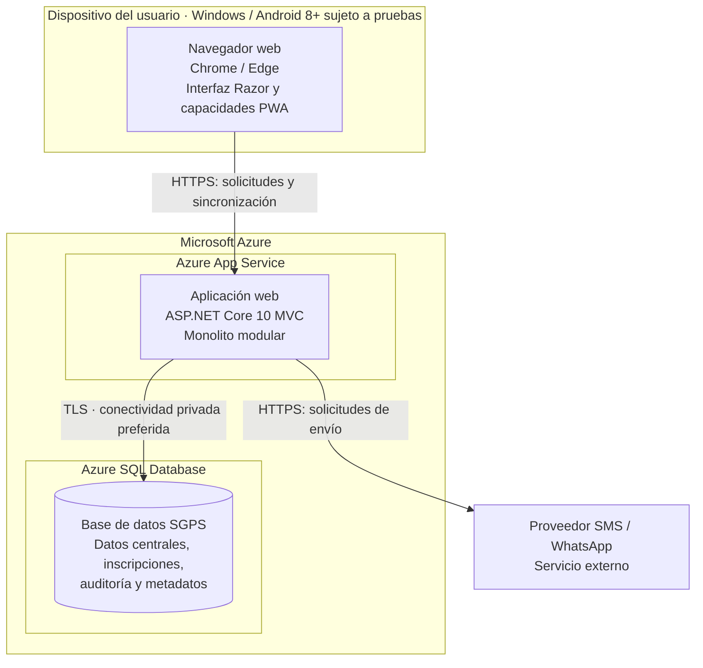

# Vista de despliegue propuesta

La siguiente vista representa una topología recomendada, no una infraestructura que ya se encuentre desplegada.

## Recomendaciones de despliegue

- Alojar la aplicación ASP.NET Core MVC en Azure App Service y mantener Azure SQL Database como servicio administrado separado.
- Restringir el acceso a la base de datos a la aplicación; no permitir acceso público irrestricto.
- Preferir conectividad privada y usar TLS para las conexiones.
- Mantener secretos fuera del repositorio y utilizar mecanismos seguros de configuración, como identidad administrada cuando sea compatible.
- Definir y probar respaldos, restauración, monitoreo y controles de acceso antes de producción.
- Verificar la matriz de navegadores y dispositivos en pruebas reales; Android 8+ es un objetivo sujeto a compatibilidad comprobada.
