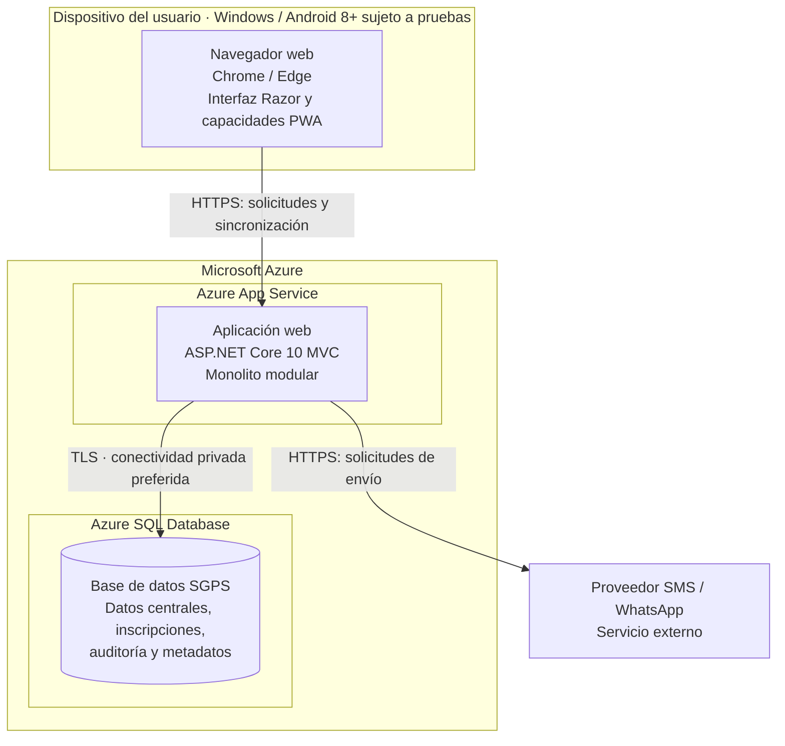

# Vista de despliegue propuesta

**Proyecto:** Sistema de Gestión de Programas Sociales – Huamanga  
**Tipo de vista:** Despliegue físico propuesto · **Versión:** 1.1 · **Estado:** no desplegado

## 1. Objetivo

Mostrar dónde se propone ejecutar la aplicación y dónde se almacenan los datos centrales, además de las conexiones de red con los usuarios y servicios externos.

| Aspecto | Descripción |
|---|---|
| Pregunta que responde | ¿Dónde se ejecutan los elementos y cómo se conectan? |
| Audiencia | Arquitectura, desarrollo y operaciones |
| Entornos considerados | Navegador de usuario, Microsoft Azure y proveedor de notificaciones |
| Advertencia | Es una propuesta de despliegue; no acredita que los recursos ya existan ni que hayan sido probados |

## 3. Nodos y relaciones

| Nodo | Elementos alojados | Relación principal |
|---|---|---|
| Dispositivo del usuario | Navegador web, interfaz Razor y capacidades PWA | Accede a la aplicación mediante HTTPS |
| Azure App Service | Aplicación ASP.NET Core 10 MVC | Atiende solicitudes y ejecuta las reglas de aplicación |
| Azure SQL Database | Datos centrales, inscripciones, auditoría y metadatos | Recibe conexiones cifradas desde la aplicación |
| Proveedor SMS / WhatsApp | Servicio externo de notificaciones | Recibe solicitudes de envío mediante HTTPS |

## 4. Recomendaciones de despliegue

- Alojar la aplicación ASP.NET Core MVC en Azure App Service y mantener Azure SQL Database como servicio administrado separado.
- Restringir el acceso a la base de datos a la aplicación; no permitir acceso público irrestricto.
- Preferir conectividad privada y usar TLS para las conexiones.
- Mantener secretos fuera del repositorio y utilizar mecanismos seguros de configuración, como identidad administrada cuando sea compatible.
- Definir y probar respaldos, restauración, monitoreo y controles de acceso antes de producción.
- Verificar la matriz de navegadores y dispositivos en pruebas reales; Android 8+ es un objetivo sujeto a compatibilidad comprobada.
