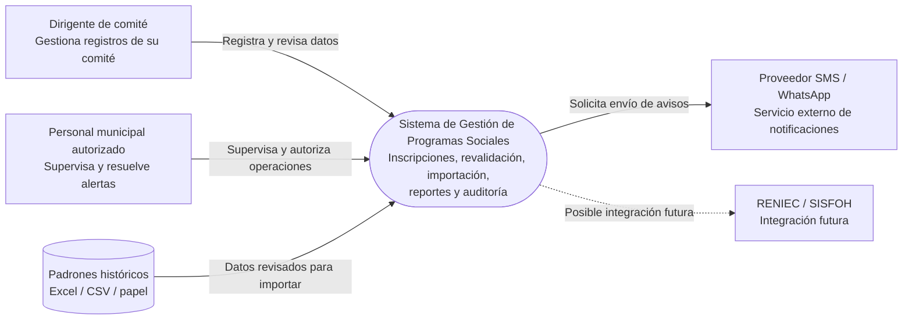

# C4 — Nivel 1: Contexto del sistema

**Sistema:** Sistema de Gestión de Programas Sociales – Huamanga.

## Alcance y supuestos

- Los usuarios directos son el dirigente de comité y el personal municipal autorizado.
- El dirigente solo puede operar sobre el comité que tiene asignado.
- Los beneficiarios reciben notificaciones, pero no inician sesión en esta versión.
- RENIEC y SISFOH quedan fuera del alcance inicial.
