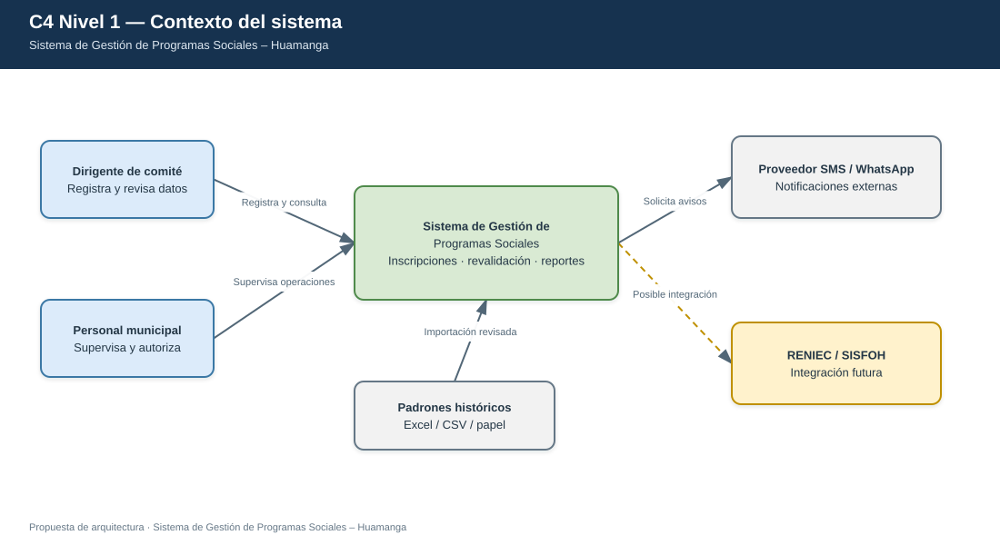

# C4 — Nivel 1: Contexto del sistema

**Sistema:** Sistema de Gestión de Programas Sociales – Huamanga.  
**Modelo:** C4 · Nivel 1 de 4 · **Versión:** 1.1 · **Estado:** propuesta de diseño

## 1. Objetivo

Mostrar el sistema como una sola unidad, identificando quiénes lo utilizan, qué responsabilidad cumple y con qué entidades o sistemas externos intercambia información.

| Aspecto | Descripción |
|---|---|
| Pregunta que responde | ¿Qué es el sistema, quién lo utiliza y con qué se relaciona? |
| Audiencia | Docente, responsables municipales, usuarios y equipo técnico |
| Qué muestra | Actores, sistema principal, fuentes de datos e integraciones externas |
| Qué no muestra | Tecnologías internas, clases, servidores ni estructura detallada de módulos |
| Siguiente vista | [Nivel 2 — Contenedores](C4-Nivel-2-Contenedores.md) |

## Versión visual estilo Draw.io

Esta es una versión gráfica adicional con el mismo contenido arquitectónico. El diagrama Mermaid original de este documento se conserva sin cambios.

- [Abrir fuente editable en Draw.io](visual/C4-Nivel-1-Contexto.drawio)

## 3. Personas y sistemas

| Elemento | Tipo | Responsabilidad o interacción |
|---|---|---|
| Dirigente de comité | Usuario directo | Registra y revisa información del comité asignado |
| Personal municipal autorizado | Usuario directo | Supervisa registros, atiende alertas y autoriza operaciones según sus permisos |
| Sistema de Gestión de Programas Sociales | Sistema en alcance | Gestiona inscripciones, revalidación, importaciones, reportes y auditoría |
| Proveedor SMS / WhatsApp | Sistema externo | Procesa solicitudes de envío de notificaciones |
| Padrones históricos | Fuente de datos | Proporciona información Excel, CSV o en papel para una carga controlada |
| RENIEC / SISFOH | Integración futura | No forma parte de la integración inicial |

## 4. Relaciones principales

| Origen | Destino | Descripción |
|---|---|---|
| Dirigente de comité | Sistema | Registra y revisa información dentro de su ámbito |
| Personal municipal | Sistema | Supervisa y resuelve operaciones que requieren autorización |
| Sistema | Proveedor SMS / WhatsApp | Solicita el envío de avisos |
| Padrones históricos | Sistema | Aportan datos revisados para una importación controlada |
| Sistema | RENIEC / SISFOH | Posible integración futura, no comprometida en la primera versión |

## 5. Alcance y supuestos

- Los usuarios directos son el dirigente de comité y el personal municipal autorizado.
- El dirigente solo puede operar sobre el comité que tiene asignado.
- Los beneficiarios reciben notificaciones, pero no inician sesión en esta versión.
- RENIEC y SISFOH quedan fuera del alcance inicial.
