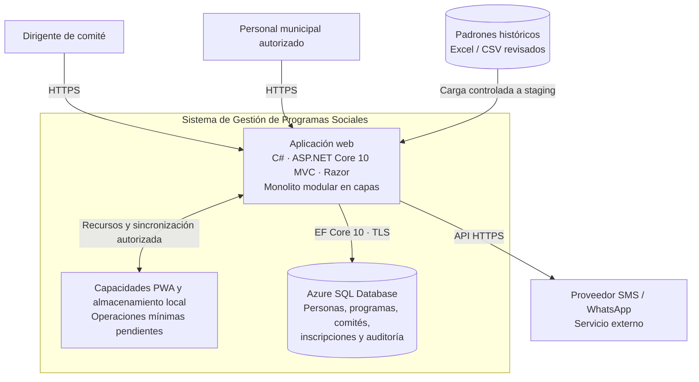

# C4 — Nivel 2: Contenedores

**Proyecto:** Sistema de Gestión de Programas Sociales – Huamanga  
**Modelo:** C4 · Nivel 2 de 4 · **Versión:** 1.1 · **Estado:** propuesta de diseño

## 1. Objetivo

Abrir la caja del sistema del nivel 1 y mostrar las aplicaciones y almacenes de datos que forman la solución, su tecnología objetivo y sus principales comunicaciones.

| Aspecto | Descripción |
|---|---|
| Pregunta que responde | ¿Qué piezas ejecutables y almacenes forman el sistema y cómo se comunican? |
| Audiencia | Arquitectura, desarrollo y responsables técnicos |
| Qué es un contenedor | Una aplicación o almacén de datos que tiene responsabilidad y ejecución o almacenamiento identificable; no significa necesariamente Docker |
| Nivel anterior | [Nivel 1 — Contexto](C4-Nivel-1-Contexto.md) |
| Siguiente vista | [Nivel 3 — Componentes](C4-Nivel-3-Componentes.md) |

## 3. Inventario de contenedores

| Contenedor | Tecnología objetivo | Responsabilidad | Información principal |
|---|---|---|---|
| Aplicación web | C# · ASP.NET Core 10 MVC · Razor | Interfaz, reglas de aplicación, autenticación y operaciones del sistema | Datos de programas, comités, personas, inscripciones, importaciones y reportes |
| Capacidades PWA | Navegador compatible, recursos web y almacenamiento local mínimo | Facilitar el uso limitado sin conexión y la sincronización posterior | Solo operaciones pendientes mínimas; no se confirma una operación hasta recibir respuesta del servidor |
| Base de datos | Azure SQL Database · acceso mediante EF Core 10 | Persistencia central y transaccional | Registros operativos, estados, auditoría y metadatos |
| Proveedor de notificaciones | API externa SMS / WhatsApp | Entregar avisos a los destinatarios | Solicitudes de envío y resultados devueltos por el proveedor |
| Padrones históricos | Excel / CSV / documentos físicos | Fuente para procesos de importación controlada | Registros sujetos a validación antes de consolidarse |

## 4. Relaciones entre contenedores y sistemas externos

| Origen | Destino | Comunicación |
|---|---|---|
| Navegador del dirigente o personal municipal | Aplicación web | HTTPS |
| Aplicación web | Capacidades PWA / almacenamiento local | Recursos de la aplicación y sincronización autorizada |
| Aplicación web | Azure SQL Database | EF Core 10 sobre conexión cifrada |
| Aplicación web | Proveedor SMS / WhatsApp | API HTTPS |
| Padrones históricos | Aplicación web | Importación a una zona temporal de revisión (staging) |

## 5. Decisiones de arquitectura

- La interfaz Razor y la lógica de aplicación forman parte de la misma aplicación ASP.NET Core MVC; no se propone un frontend React separado.
- Azure SQL Database es el almacenamiento central seleccionado.
- El almacenamiento local de la PWA no confirma por sí solo una inscripción: la confirmación depende de la respuesta del servidor.
- Los datos locales deben minimizarse y protegerse; no se almacenará información personal sensible en la caché estática.
- La conectividad privada a la base de datos es preferida y no debe habilitarse acceso público irrestricto.
