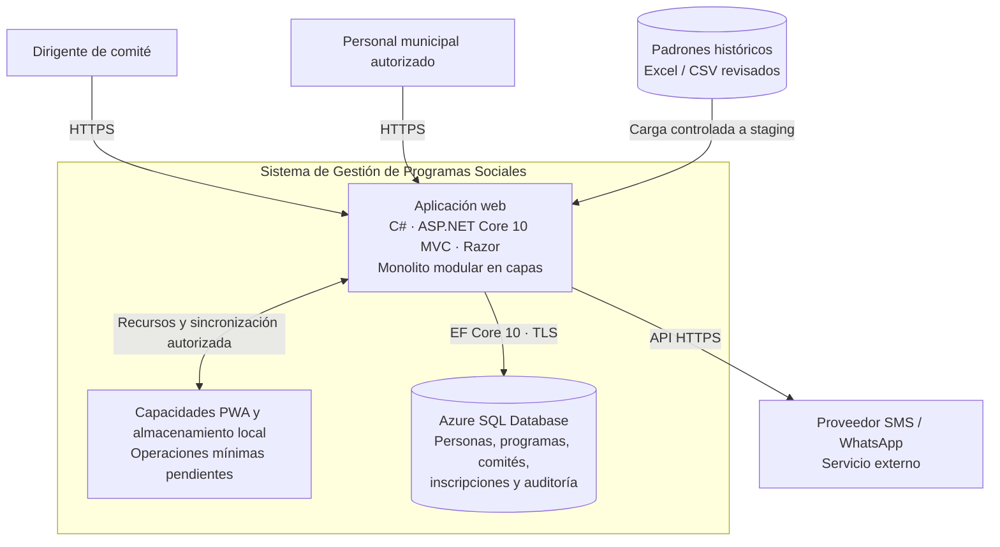

# C4 — Nivel 2: Contenedores

Este nivel presenta las principales piezas de ejecución y almacenamiento propuestas para el sistema.

## Decisiones de arquitectura

- La interfaz Razor y la lógica de aplicación forman parte de la misma aplicación ASP.NET Core MVC; no se propone un frontend React separado.
- Azure SQL Database es el almacenamiento central seleccionado.
- El almacenamiento local de la PWA no confirma por sí solo una inscripción: la confirmación depende de la respuesta del servidor.
- Los datos locales deben minimizarse y protegerse; no se almacenará información personal sensible en la caché estática.
- La conectividad privada a la base de datos es preferida y no debe habilitarse acceso público irrestricto.
