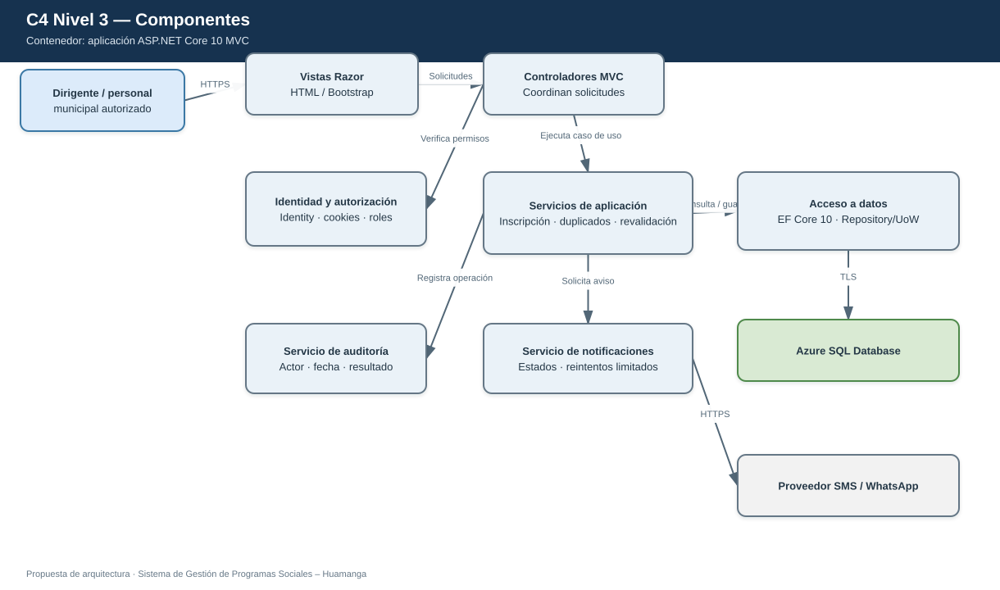
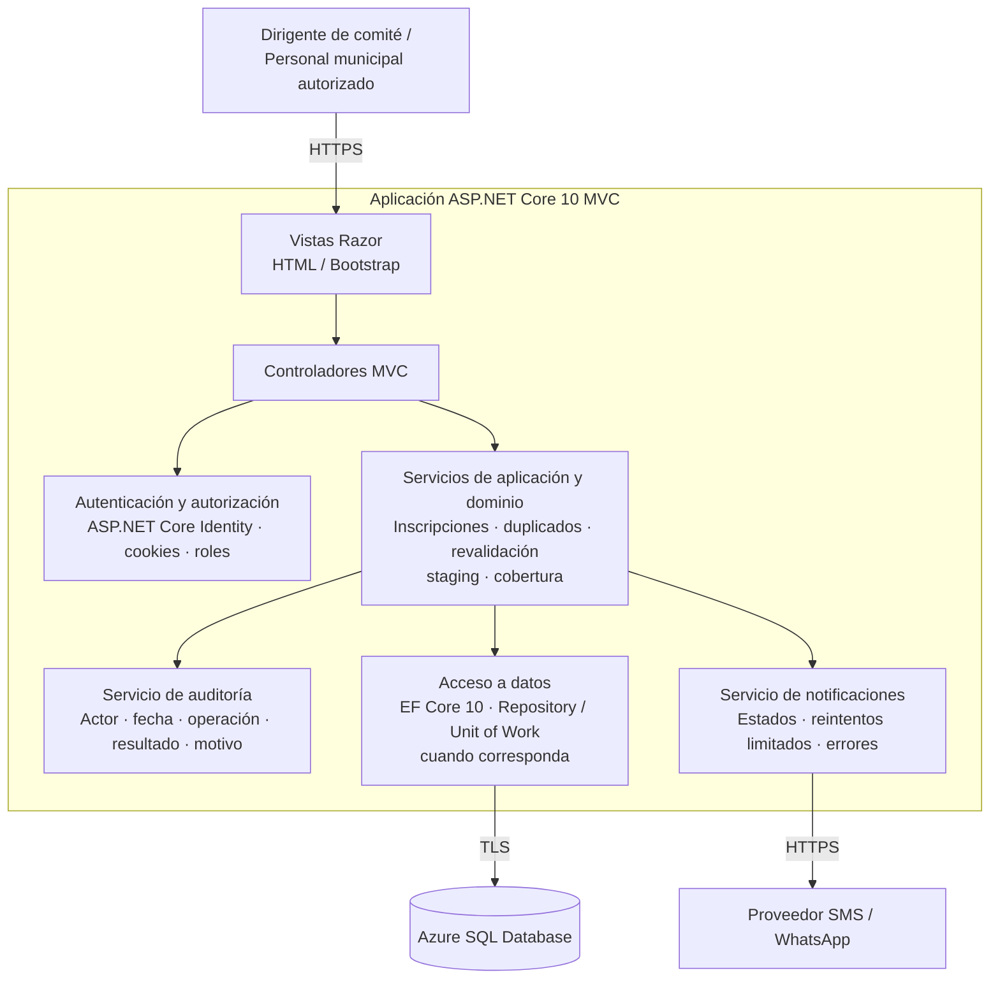

# C4 — Nivel 3: Componentes de la aplicación web

**Proyecto:** Sistema de Gestión de Programas Sociales – Huamanga  
**Contenedor detallado:** Aplicación web ASP.NET Core 10 MVC  
**Modelo:** C4 · Nivel 3 de 4 · **Versión:** 1.1 · **Estado:** propuesta de diseño

## 1. Objetivo

Abrir el contenedor de aplicación web del nivel 2 y mostrar los componentes lógicos, sus responsabilidades y las relaciones que mantienen con otros componentes y servicios externos.

| Aspecto | Descripción |
|---|---|
| Pregunta que responde | ¿Cómo se divide internamente la aplicación y qué hace cada parte? |
| Audiencia | Arquitectura y equipo de desarrollo |
| Qué muestra | Vistas, controladores, autenticación, servicios, auditoría, notificaciones y persistencia |
| Nivel anterior | [Nivel 2 — Contenedores](C4-Nivel-2-Contenedores.md) |
| Vista de código complementaria | [Nivel 4 — Código](C4-Nivel-4-Codigo.md) |

## Versión visual estilo Draw.io

Esta es una versión gráfica adicional con el mismo contenido arquitectónico. El diagrama Mermaid original de este documento se conserva sin cambios.

- [Abrir fuente editable en Draw.io](visual/C4-Nivel-3-Componentes.drawio)

## 3. Inventario de componentes

| Componente | Responsabilidad | Controles principales |
|---|---|---|
| Vistas Razor | Presentar formularios, tablas, estados y resultados | Validación de presentación y mensajes accesibles |
| Controladores MVC | Recibir solicitudes y coordinar la respuesta HTTP | No concentrar reglas de negocio ni acceso directo arbitrario a datos |
| Identidad y autorización | Autenticar y aplicar permisos por rol | ASP.NET Core Identity, cookies y autorización por rol/ámbito |
| Servicios de aplicación y dominio | Aplicar reglas de inscripción, duplicados, revalidación, importación y cobertura | Validación de negocio en servidor y transacciones cuando corresponda |
| Servicio de auditoría | Registrar actor, fecha, operación, resultado y motivo | Historial protegido frente a edición por usuarios ordinarios |
| Servicio de notificaciones | Solicitar avisos y manejar resultados | Estados, reintentos limitados y registro de errores |
| Acceso a datos | Persistir y consultar información central | EF Core 10; Repository / Unit of Work solo cuando aporten valor |

## 4. Relaciones entre componentes

| Origen | Destino | Responsabilidad de la relación |
|---|---|---|
| Vistas Razor | Controladores MVC | Enviar solicitudes y mostrar resultados |
| Controladores MVC | Identidad y autorización | Verificar sesión y permisos requeridos |
| Controladores MVC | Servicios de aplicación y dominio | Ejecutar casos de uso |
| Servicios de aplicación | Acceso a datos | Consultar y guardar datos mediante operaciones autorizadas |
| Servicios de aplicación | Servicio de auditoría | Registrar operaciones relevantes |
| Servicios de aplicación | Servicio de notificaciones | Solicitar avisos relacionados con eventos del sistema |
| Acceso a datos | Azure SQL Database | Persistencia cifrada |
| Servicio de notificaciones | Proveedor SMS / WhatsApp | Enviar solicitudes por API HTTPS |

## 5. Responsabilidades y controles

- Los controladores coordinan las solicitudes; las reglas de negocio deben residir en servicios y no depender de la interfaz.
- La autorización se verifica en el servidor según rol y ámbito del comité.
- La auditoría conserva eventos relevantes como nuevas operaciones; los usuarios ordinarios no pueden editar ni borrar el historial.
- Los fallos de SMS/WhatsApp se registran y gestionan sin revertir una inscripción confirmada.
- Este diseño es una propuesta pendiente de implementación y pruebas.
