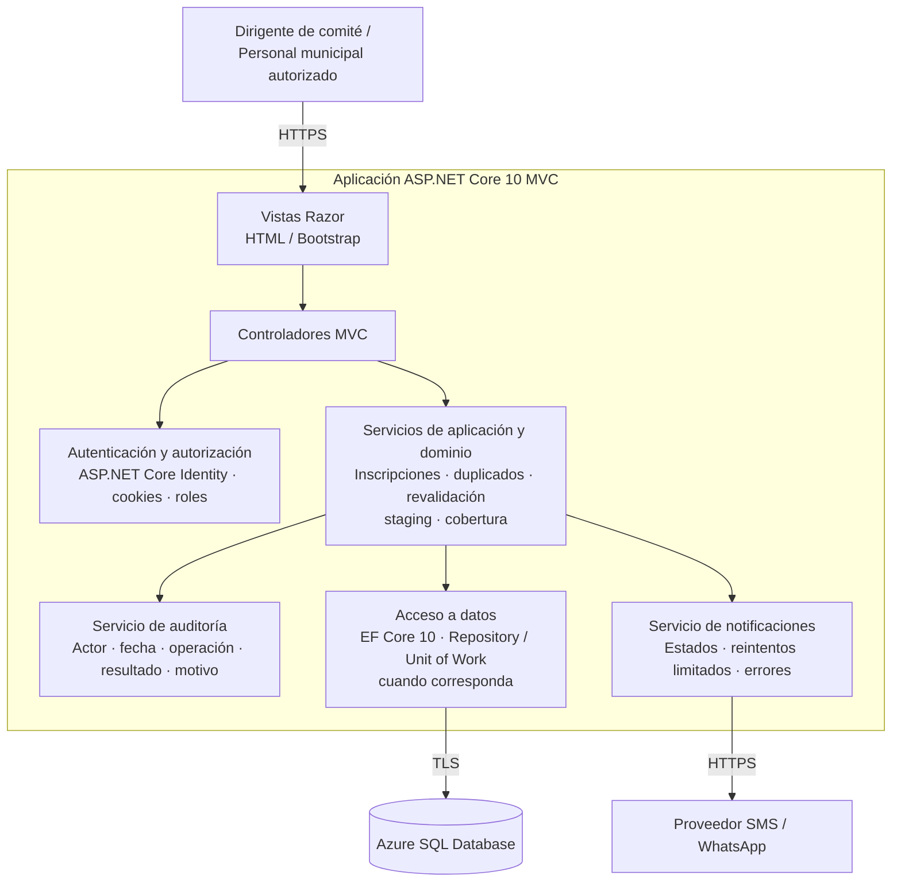

# C4 — Nivel 3: Componentes de la aplicación web

Vista lógica propuesta de los componentes principales dentro de la aplicación ASP.NET Core 10 MVC.

## Responsabilidades y controles

- Los controladores coordinan las solicitudes; las reglas de negocio deben residir en servicios y no depender de la interfaz.
- La autorización se verifica en el servidor según rol y ámbito del comité.
- La auditoría conserva eventos relevantes como nuevas operaciones; los usuarios ordinarios no pueden editar ni borrar el historial.
- Los fallos de SMS/WhatsApp se registran y gestionan sin revertir una inscripción confirmada.
- Este diseño es una propuesta pendiente de implementación y pruebas.
