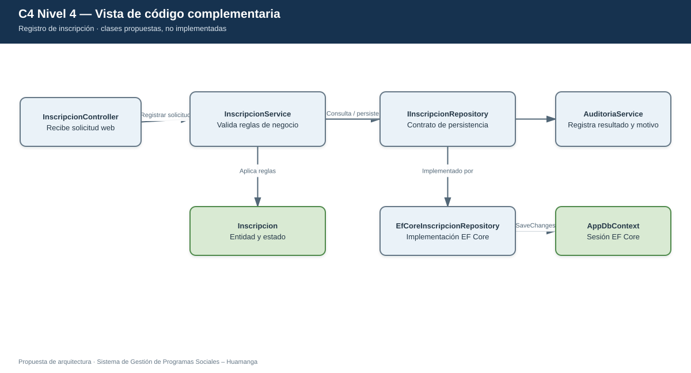
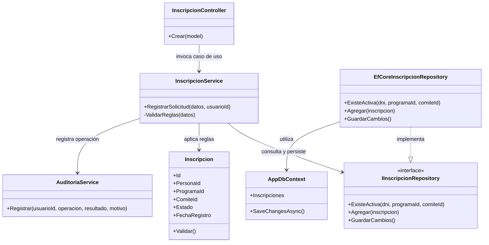
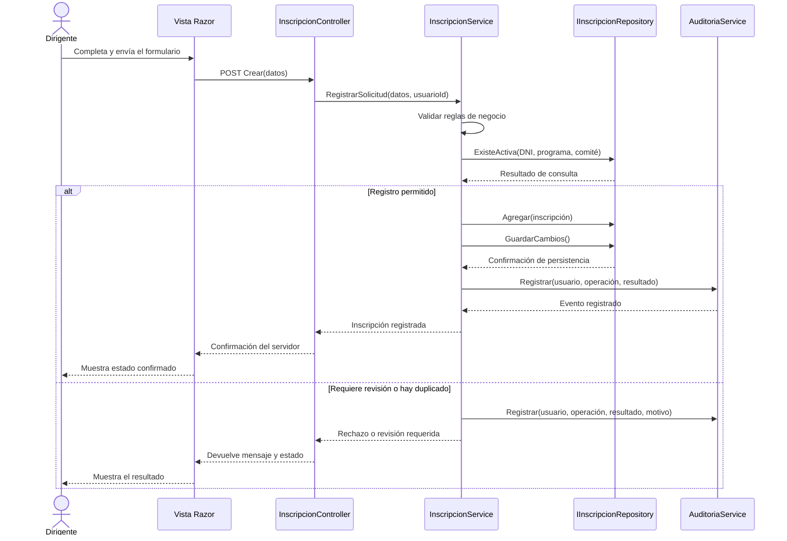

# C4 — Nivel 4: Código (vista complementaria)

**Proyecto:** Sistema de Gestión de Programas Sociales – Huamanga  
**Componente de referencia:** Registro de inscripciones  
**Modelo:** Vista de código complementaria · **Notación:** Mermaid UML · **Versión:** 1.0  
**Estado:** diseño ilustrativo; las clases no representan código ya implementado.

## 1. Objetivo

Mostrar, de forma selectiva, cómo podrían colaborar las clases principales de un caso de uso. Esta vista complementa los niveles 1, 2 y 3; no reemplaza la documentación de requisitos ni implica que la aplicación ya esté construida.

| Aspecto | Descripción |
|---|---|
| Pregunta que responde | ¿Qué clases colaboran para registrar una inscripción y qué responsabilidad tiene cada una? |
| Audiencia | Docente y equipo de desarrollo |
| Alcance | Registro de una inscripción con validación de negocio, persistencia y auditoría |
| Nivel anterior | [Nivel 3 — Componentes](C4-Nivel-3-Componentes.md) |

## 2. Diagrama de clases

## Versión visual estilo Draw.io

Esta es una versión gráfica adicional con el mismo contenido arquitectónico. El diagrama Mermaid original de este documento se conserva sin cambios.

- [Abrir fuente editable en Draw.io](visual/C4-Nivel-4-Codigo.drawio)

## 3. Responsabilidad de las clases

| Clase o interfaz | Responsabilidad propuesta |
|---|---|
| `InscripcionController` | Recibir la solicitud web, comprobar el modelo de entrada y devolver una respuesta apropiada. |
| `InscripcionService` | Coordinar el caso de uso y aplicar las reglas de negocio en el servidor. |
| `Inscripcion` | Representar la inscripción y sus datos/estados relevantes. |
| `IInscripcionRepository` | Definir el contrato de consulta y persistencia sin acoplar el servicio a EF Core. |
| `EfCoreInscripcionRepository` | Implementar el contrato usando Entity Framework Core 10. |
| `AppDbContext` | Representar la sesión de trabajo con Azure SQL Database mediante EF Core. |
| `AuditoriaService` | Registrar quién realizó la operación, cuándo ocurrió, el resultado y el motivo cuando corresponda. |

## 4. Diagrama de secuencia: registrar una inscripción

## 5. Reglas y límites de interpretación

- La validación definitiva debe ejecutarse en el servidor; una validación de interfaz no es suficiente.
- El DNI identifica a la persona, pero no se trata como una clave global que impida participar en programas distintos.
- Las reglas de duplicidad por programa y comité deben seguir lo establecido en los requisitos funcionales y quedar sujetas a validación municipal.
- Una operación no debe mostrarse como confirmada hasta que el servidor informe que se guardó correctamente.
- La persistencia y la auditoría deben coordinarse para no comunicar una confirmación falsa. La estrategia transaccional concreta se definirá durante la implementación.
- Los nombres de clases son una propuesta de diseño, no archivos de código que existan actualmente en el repositorio.
