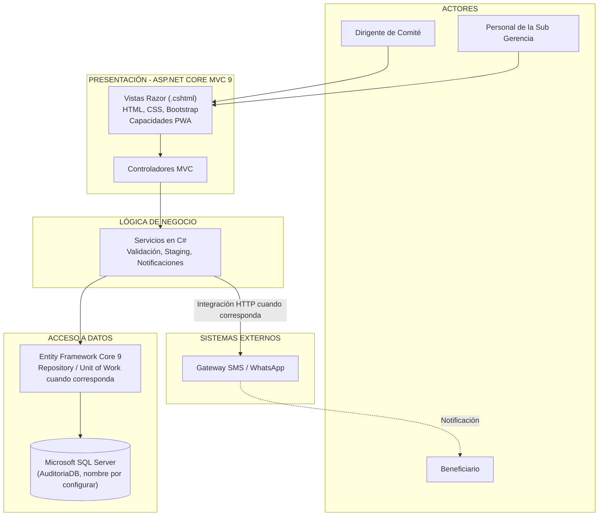

# Arquitectura inicial del sistema

## 1. Stack tecnológico de referencia

Esta arquitectura se define de acuerdo con el `README.md` del repositorio. La aplicación será un **monolito modular** desarrollado con **C# y ASP.NET Core 10 MVC**, con vistas Razor (`.cshtml`), **Entity Framework Core 10** y **Azure SQL Database**.

La interfaz se renderiza mediante Razor dentro de ASP.NET Core MVC; no se plantea un frontend independiente en React ni un backend separado con Node.js/Express. Las capacidades PWA y el soporte offline se incorporarán a la aplicación web dentro del alcance del proyecto.

## 2. Diagrama de arquitectura

## 3. Descripción de las capas

- **Presentación:** permite la interacción mediante vistas Razor (`.cshtml`) con HTML5, CSS3 y Bootstrap. La interfaz será adaptable a distintos dispositivos y podrá incorporar capacidades PWA para apoyar el trabajo en zonas con conectividad limitada. Los controladores MVC reciben las peticiones HTTP.
- **Lógica de negocio:** contiene servicios en C# para autenticación y autorización, registro, staging, validación de duplicados, revalidación, cobertura, reportes y notificaciones.
- **Acceso a datos:** utiliza Entity Framework Core 10 para consultar y persistir la información en Azure SQL Database. Los patrones Repository y Unit of Work se aplicarán cuando aporten una separación clara de responsabilidades y control transaccional.

La solución se despliega como un único sistema organizado en módulos cohesionados. La separación por capas es lógica y no implica desplegar un frontend y un backend como aplicaciones independientes.

## 4. Asignación de requisitos a módulos

| Módulo | Requisitos | Responsabilidad |
| :--- | :--- | :--- |
| Autenticación y autorización | RF-12, RF-13, RNF-04 | Se utilizará ASP.NET Core Identity con autenticación basada en cookies y autorización por roles, coherente con la aplicación web ASP.NET Core MVC con vistas Razor. JWT no será el mecanismo predeterminado; solo se evaluará si se define una API para clientes independientes. Esta es la decisión de diseño prevista, no una afirmación de que ya esté implementada. |
| Registro y padrón | RF-01, RF-03, RF-05, RF-14 | Mantener la identidad de la persona separada de sus inscripciones por programa y comité, gestionar el padrón y conservar el historial de cambios. |
| Detección de duplicados | RF-02, RF-04 | Bloquear inscripciones activas repetidas en el mismo programa y comité; alertar y derivar a revisión los casos detectados en otro comité del mismo programa. La coincidencia en otro programa no se considera automáticamente un duplicado. |
| Revalidación periódica | RF-06 | Gestionar el proceso de revalidación según la periodicidad definida. |
| Notificaciones | RF-07 | Gestionar las notificaciones mediante un gateway externo SMS/WhatsApp. |
| Cobertura y reportes | RF-08, RF-09, RF-10 | Consultar información y generar reportes de beneficiarios activos por zona. |
| Staging | RF-11 | Importar datos históricos de Excel/CSV, validarlos y limpiarlos antes de incorporarlos al padrón definitivo. |

## 5. Reglas de dependencia

- **Flujo principal:** las vistas Razor interactúan con los controladores; los controladores delegan las reglas del dominio a los servicios; los servicios acceden a la persistencia mediante Entity Framework Core 10.
- **Acceso a datos:** las vistas y los controladores no deben consultar directamente la base de datos.
- **Inyección de dependencias:** los servicios y componentes de persistencia necesarios se registran en el contenedor nativo de ASP.NET Core, configurado desde `Program.cs`.
- **Integraciones externas:** las comunicaciones con el gateway SMS/WhatsApp se encapsulan en servicios y pueden realizarse mediante `HttpClient`; no se llaman directamente desde las vistas.
- **Sincronización offline:** la PWA conserva en almacenamiento local los registros pendientes y un identificador único por operación. Al recuperar conexión, los envía al servidor; los reintentos deben ser idempotentes. El servidor valida duplicados y reglas de negocio antes de confirmar el alta. Un conflicto queda marcado para revisión, sin sobrescritura automática, y la interfaz informa el estado de cada registro.
- **Transacciones:** las operaciones que deban mantener la consistencia del padrón se gestionan con transacciones y restricciones apropiadas en Azure SQL Database.

## 6. Justificaciones de diseño

- **Staging separado del padrón:** los archivos históricos de Excel o CSV pueden contener errores y duplicados. El staging permite validar y limpiar esos datos antes de consolidarlos en el padrón principal.
- **Persistencia transaccional:** Entity Framework Core 10 junto con Azure SQL Database permite coordinar operaciones relacionadas y mantener la integridad de la información.
- **Monolito modular:** una aplicación desplegable con módulos bien delimitados reduce la complejidad operativa para el tamaño y alcance del proyecto.
- **PWA:** las capacidades web progresivas pueden ayudar a los usuarios en zonas con conectividad limitada. Para los registros offline, se mantendrán estados visibles (pendiente, sincronizando, sincronizado o requiere revisión/error), reintentos con espera progresiva ante fallos temporales y validación final en el servidor. Los registros locales no se considerarán confirmados hasta recibir respuesta del servidor. La aplicación no sobrescribirá automáticamente datos ante conflictos. Se debe limitar la información personal almacenada localmente y evitar incluir datos sensibles en la caché de recursos estáticos.

## Política de autorización por rol y comité

- **Dirigente de comité:** solo puede consultar y gestionar los beneficiarios, inscripciones y operaciones de su comité asignado. No puede consultar ni modificar los registros detallados de otros comités.
- **Personal autorizado de la Sub Gerencia:** puede consultar el padrón consolidado y gestionar las tareas de supervisión, reportes y revisión de posibles duplicados dentro del ámbito municipal que tenga autorizado.
- **Administrador designado de usuarios:** función asignada únicamente al personal municipal autorizado por la Municipalidad. Puede crear, actualizar o desactivar cuentas, asignar roles y vincular dirigentes con sus comités. La asignación o reasignación debe quedar registrada en la auditoría.
- **Decisiones sobre duplicados:** corresponde al personal autorizado de la Sub Gerencia revisar y registrar el resultado, el motivo y el responsable; el dirigente no puede aprobar por sí solo un caso que involucre a otro comité.
- **Aplicación de permisos:** cada solicitud debe validarse en el servidor, no solo ocultando botones o pantallas. Los intentos de acceso fuera del ámbito autorizado se rechazarán y registrarán cuando corresponda.
- **Cambios de asignación:** cuando se reasigne o desactive una cuenta, los permisos nuevos deben aplicarse de inmediato en las siguientes solicitudes. Las operaciones offline se volverán a autorizar en el servidor al sincronizarse.
- **Principio de mínimo privilegio:** los roles se asignan por necesidad funcional; no se presume que todo usuario municipal sea administrador.

Esta política es la propuesta de diseño para documentar y validar con la Municipalidad antes de implementar. No afirma que la autorización ya esté programada o probada.

## Política de acceso seguro a Azure SQL Database

En producción, la base de datos no debe aceptar conexiones públicas irrestrictas. Se prefiere la conectividad privada desde Azure App Service. Si no es viable, se documentarán reglas de firewall restrictivas que permitan únicamente los orígenes necesarios. Cuando sea compatible con el entorno, se usará la identidad administrada de App Service con permisos mínimos. Las cadenas de conexión y credenciales deben configurarse fuera del repositorio. Cualquier acceso temporal de desarrollo se limitará a las IP autorizadas y se retirará al terminar las pruebas. Estas medidas deberán verificarse antes del despliegue; aún no se han probado en una infraestructura real.

## Criterios de compatibilidad de la base de datos

La persistencia objetivo es Azure SQL Database, accedida mediante Entity Framework Core 10 y el proveedor Microsoft.EntityFrameworkCore.SqlServer. Antes de desplegar se deberán probar las migraciones Code-First y las consultas en un entorno de prueba de Azure SQL Database, incluyendo tipos de datos, índices, restricciones, transacciones y reglas de integridad. No se debe asumir que todas las funciones de SQL Server autoadministrado están disponibles de forma idéntica en Azure SQL Database. Las credenciales no deben guardarse en GitHub. Estas comprobaciones siguen pendientes hasta que se incorpore la implementación.

## 7. Vista de contexto

Esta vista muestra el sistema y sus actores externos. La estructura interna se detalla en el diagrama por capas anterior.

## 8. Consistencia con el README

Los documentos de arquitectura deben mantener como referencia común el siguiente stack:

- **Backend:** C# con ASP.NET Core 10.
- **Patrón web:** ASP.NET Core MVC.
- **Presentación:** vistas Razor (`.cshtml`), HTML5, CSS3 y Bootstrap.
- **ORM:** Entity Framework Core 10.
- **Base de datos:** Azure SQL Database.
- **Estilo de despliegue:** monolito modular organizado en capas.
- **PWA:** capacidades progresivas/offline dentro del alcance acordado.

React, Node.js, Express, Prisma y PostgreSQL no forman parte del stack elegido. Los diagramas existentes se conservan sin cambios, según la instrucción del proyecto; las etiquetas de base de datos que aparecen en ellos son representaciones conceptuales y no sustituyen la decisión de despliegue recomendada: Azure SQL Database.

## Flujo de revalidación de inscripciones

1. El sistema identifica las inscripciones que se aproximan a su fecha de revalidación semestral y crea una tarea pendiente.
2. Se notifica al dirigente del comité asignado y, cuando corresponda y exista un canal válido, al beneficiario. La notificación no debe exponer datos personales innecesarios.
3. El dirigente verifica la información conforme a los criterios aprobados para el programa y registra la evidencia o el resultado de la revisión.
4. Los casos dudosos, disputados o que puedan afectar la continuidad del apoyo se derivan a personal autorizado de la Sub Gerencia.
5. El resultado se registra sobre la inscripción específica: pendiente, en revisión, revalidada o no revalidada, junto con fecha, responsable y motivo. Los nombres definitivos de estados deben validarse con el área usuaria.
6. Si no hay respuesta, la inscripción permanece pendiente y se genera un recordatorio o escalamiento según los plazos que apruebe la Municipalidad. El vencimiento por sí solo no produce una baja automática.
7. Una decisión de no revalidación requiere revisión y registro de la causa por personal autorizado, siguiendo el procedimiento municipal. No debe desactivar a la persona ni afectar sus inscripciones en otros programas de forma automática.

La periodicidad semestral es la regla propuesta actualmente. Los responsables, evidencias aceptadas, plazos de recordatorio, decisión final y tratamiento de casos sin respuesta deben ser confirmados por la Municipalidad antes de implementar. Este flujo es una propuesta documentada, no una funcionalidad ya implementada.

## Aclaración del alcance de los actores

En el alcance actual, los usuarios que interactúan directamente con las vistas son el dirigente de comité y el personal municipal autorizado. El beneficiario se identifica como destinatario de notificaciones SMS/WhatsApp y no requiere iniciar sesión ni utilizar una interfaz en esta versión. Si una versión futura incorpora un portal o aplicación para beneficiarios, deberá documentarse como un cambio de alcance y actualizarse entonces el modelo de actores correspondiente.
