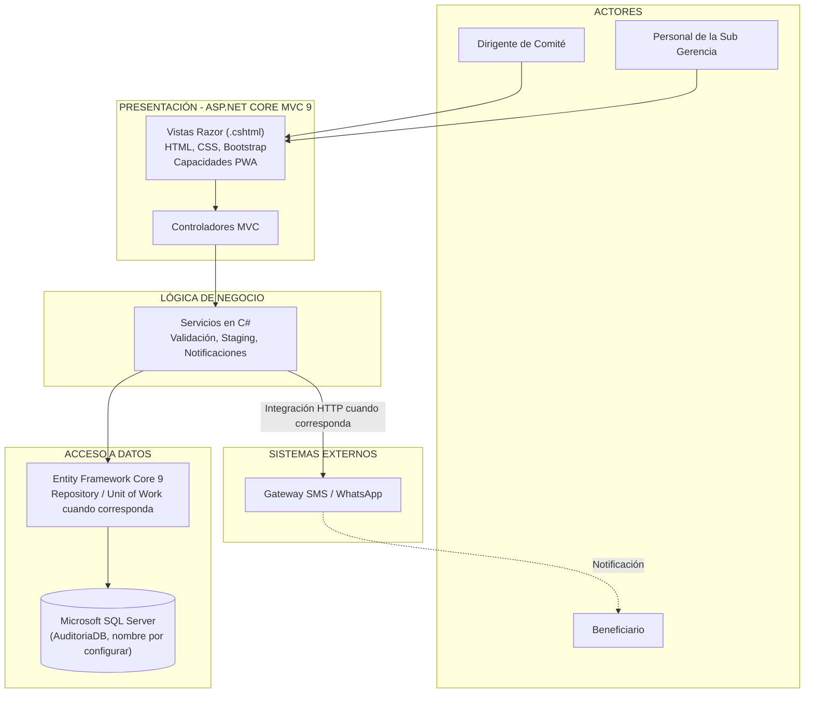
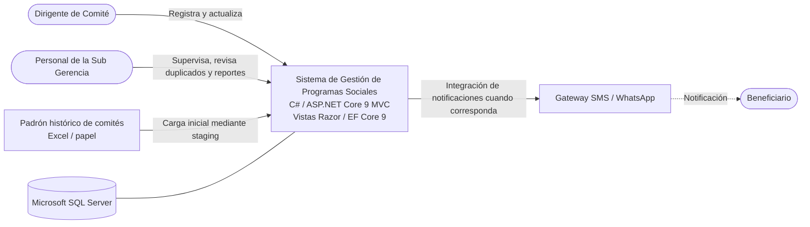

# Arquitectura inicial del sistema

## 1. Stack tecnológico de referencia

Esta arquitectura se define de acuerdo con el `README.md` del repositorio. La aplicación será un **monolito modular** desarrollado con **C# y ASP.NET Core 9 MVC**, con vistas Razor (`.cshtml`), **Entity Framework Core 9** y **Microsoft SQL Server**.

La interfaz se renderiza mediante Razor dentro de ASP.NET Core MVC; no se plantea un frontend independiente en React ni un backend separado con Node.js/Express. Las capacidades PWA y el soporte offline se incorporarán a la aplicación web dentro del alcance del proyecto.

## 2. Diagrama de arquitectura

## 3. Descripción de las capas

- **Presentación:** permite la interacción mediante vistas Razor (`.cshtml`) con HTML5, CSS3 y Bootstrap. La interfaz será adaptable a distintos dispositivos y podrá incorporar capacidades PWA para apoyar el trabajo en zonas con conectividad limitada. Los controladores MVC reciben las peticiones HTTP.
- **Lógica de negocio:** contiene servicios en C# para autenticación y autorización, registro, staging, validación de duplicados, revalidación, cobertura, reportes y notificaciones.
- **Acceso a datos:** utiliza Entity Framework Core 9 para consultar y persistir la información en Microsoft SQL Server. Los patrones Repository y Unit of Work se aplicarán cuando aporten una separación clara de responsabilidades y control transaccional.

La solución se despliega como un único sistema organizado en módulos cohesionados. La separación por capas es lógica y no implica desplegar un frontend y un backend como aplicaciones independientes.

## 4. Asignación de requisitos a módulos

| Módulo | Requisitos | Responsabilidad |
| :--- | :--- | :--- |
| Autenticación y autorización | RF-12, RF-13, RNF-04 | Validar credenciales y controlar el acceso por roles. ASP.NET Core Identity podrá utilizarse si forma parte de la implementación. |
| Registro y padrón | RF-01, RF-03, RF-05, RF-14 | Registrar y actualizar beneficiarios por comité y conservar el historial de cambios. |
| Detección de duplicados | RF-02, RF-04 | Comprobar duplicados de DNI según las reglas del sistema y generar alertas para la Sub Gerencia. |
| Revalidación periódica | RF-06 | Gestionar el proceso de revalidación según la periodicidad definida. |
| Notificaciones | RF-07 | Gestionar las notificaciones mediante un gateway externo SMS/WhatsApp. |
| Cobertura y reportes | RF-08, RF-09, RF-10 | Consultar información y generar reportes de beneficiarios activos por zona. |
| Staging | RF-11 | Importar datos históricos de Excel/CSV, validarlos y limpiarlos antes de incorporarlos al padrón definitivo. |

## 5. Reglas de dependencia

- **Flujo principal:** las vistas Razor interactúan con los controladores; los controladores delegan las reglas del dominio a los servicios; los servicios acceden a la persistencia mediante Entity Framework Core 9.
- **Acceso a datos:** las vistas y los controladores no deben consultar directamente la base de datos.
- **Inyección de dependencias:** los servicios y componentes de persistencia necesarios se registran en el contenedor nativo de ASP.NET Core, configurado desde `Program.cs`.
- **Integraciones externas:** las comunicaciones con el gateway SMS/WhatsApp se encapsulan en servicios y pueden realizarse mediante `HttpClient`; no se llaman directamente desde las vistas.
- **Sincronización offline:** la PWA conserva en almacenamiento local los registros pendientes y un identificador único por operación. Al recuperar conexión, los envía al servidor; los reintentos deben ser idempotentes. El servidor valida duplicados y reglas de negocio antes de confirmar el alta. Un conflicto queda marcado para revisión, sin sobrescritura automática, y la interfaz informa el estado de cada registro.
- **Transacciones:** las operaciones que deban mantener la consistencia del padrón se gestionan con transacciones y restricciones apropiadas en SQL Server.

## 6. Justificaciones de diseño

- **Staging separado del padrón:** los archivos históricos de Excel o CSV pueden contener errores y duplicados. El staging permite validar y limpiar esos datos antes de consolidarlos en el padrón principal.
- **Persistencia transaccional:** Entity Framework Core 9 junto con SQL Server permite coordinar operaciones relacionadas y mantener la integridad de la información.
- **Monolito modular:** una aplicación desplegable con módulos bien delimitados reduce la complejidad operativa para el tamaño y alcance del proyecto.
- **PWA:** las capacidades web progresivas pueden ayudar a los usuarios en zonas con conectividad limitada. Para los registros offline, se mantendrán estados visibles (pendiente, sincronizando, sincronizado o requiere revisión/error), reintentos con espera progresiva ante fallos temporales y validación final en el servidor. Los registros locales no se considerarán confirmados hasta recibir respuesta del servidor. La aplicación no sobrescribirá automáticamente datos ante conflictos. Se debe limitar la información personal almacenada localmente y evitar incluir datos sensibles en la caché de recursos estáticos.

## 7. Vista de contexto

Esta vista muestra el sistema y sus actores externos. La estructura interna se detalla en el diagrama por capas anterior.

## 8. Consistencia con el README

Los documentos de arquitectura deben mantener como referencia común el siguiente stack:

- **Backend:** C# con ASP.NET Core 9.
- **Patrón web:** ASP.NET Core MVC.
- **Presentación:** vistas Razor (`.cshtml`), HTML5, CSS3 y Bootstrap.
- **ORM:** Entity Framework Core 9.
- **Base de datos:** Microsoft SQL Server.
- **Estilo de despliegue:** monolito modular organizado en capas.
- **PWA:** capacidades progresivas/offline dentro del alcance acordado.

React, Node.js, Express, Prisma y PostgreSQL no forman parte del stack aprobado en el `README.md`, salvo que el equipo acuerde formalmente una modificación y actualice toda la documentación relacionada.
