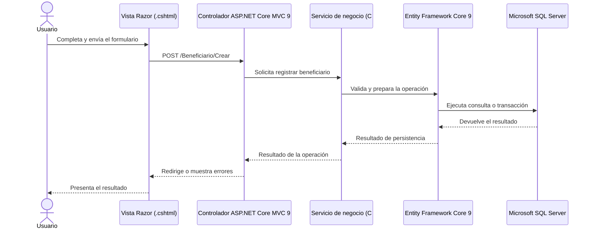

# Enfoque arquitectónico: Patrón MVC

**Proyecto:** Sistema de Gestión de Programas Sociales – Huamanga  
**Curso:** Arquitectura de Software (IS-488) – Semestre 2026-II

## 1. Definición del enfoque

El sistema utilizará el patrón **Modelo-Vista-Controlador (MVC)** implementado con **C# y ASP.NET Core 10 MVC**, conforme al stack tecnológico establecido en el `README.md`. La aplicación se desplegará como un **monolito modular**: un único sistema organizado en módulos y capas con responsabilidades definidas.

La presentación se implementará con vistas Razor (`.cshtml`), el acceso a datos se realizará mediante Entity Framework Core 10 y la persistencia se gestionará en Azure SQL Database. No se plantea un frontend independiente en React ni un backend separado con Node.js/Express.

## 2. Componentes del patrón MVC

- **Modelo (Model):** representa las entidades y los datos del dominio, así como las reglas y servicios que procesan la información. El acceso a la persistencia se realizará mediante Entity Framework Core 10. Los patrones Repository y Unit of Work podrán utilizarse donde aporten claridad y control transaccional.
- **Vista (View):** presenta la información al usuario mediante vistas Razor (`.cshtml`), HTML5, CSS3 y Bootstrap. La interfaz deberá adaptarse a diferentes tamaños de pantalla y podrá incorporar capacidades PWA para apoyar el trabajo con conectividad limitada.
- **Controlador (Controller):** recibe las peticiones HTTP, valida la entrada, coordina los servicios de negocio y devuelve la vista o respuesta apropiada. Los controladores no deben concentrar reglas de negocio ni acceder directamente a la base de datos.

## 3. Flujo de trabajo: registrar un beneficiario

## 4. Organización lógica de la solución

| Componente | Responsabilidad | Tecnología |
|---|---|---|
| Presentación | Formularios, listados y mensajes de respuesta. | Vistas Razor (`.cshtml`), HTML5, CSS3 y Bootstrap. |
| Controladores | Recibir solicitudes HTTP y coordinar el flujo de la aplicación. | ASP.NET Core MVC 10. |
| Servicios de negocio | Aplicar reglas del padrón, validar duplicados, gestionar staging, reportes y notificaciones. | C# sobre .NET 10. |
| Persistencia | Consultar y guardar información con control de integridad. | Entity Framework Core 10. |
| Base de datos | Almacenar beneficiarios, programas, comités, inscripciones y registros de auditoría. | Azure SQL Database. |
| Integraciones externas | Enviar notificaciones por SMS/WhatsApp cuando corresponda. | Servicio de integración encapsulado en la capa de negocio. |

## 5. Reglas de dependencia

1. **Presentación:** las vistas se comunican con los controladores; no acceden directamente a la base de datos.
2. **Controladores:** coordinan las peticiones y delegan las reglas del dominio a los servicios.
3. **Lógica de negocio:** centraliza validaciones, reglas de duplicidad, staging, reportes y notificaciones.
4. **Persistencia:** los servicios acceden a los datos mediante la capa de persistencia basada en Entity Framework Core 10.
5. **Inyección de dependencias:** los servicios y repositorios necesarios se registran en el contenedor nativo de ASP.NET Core, configurado desde `Program.cs`.
6. **Integraciones externas:** las llamadas a un gateway SMS/WhatsApp se encapsulan en servicios; no se realizan directamente desde las vistas.
7. **Transacciones:** las operaciones que deban mantener consistencia se ejecutan con transacciones apropiadas en Azure SQL Database.

## 6. Asignación de requisitos a módulos

| Módulo | Requisitos relacionados | Responsabilidad |
|---|---|---|
| Autenticación y autorización | RF-12, RF-13, RNF-04 | Se utilizará ASP.NET Core Identity con autenticación basada en cookies y autorización por roles para la aplicación web MVC con Razor. JWT no será el mecanismo predeterminado; solo se evaluará si se define una API para clientes independientes. Esta es la decisión de diseño prevista, no una afirmación de que ya esté implementada. |
| Registro y padrón | RF-01, RF-03, RF-05, RF-14 | Separar la identidad de la persona de sus inscripciones por programa y comité, gestionar el padrón y conservar el historial de cambios. |
| Detección de duplicados | RF-02, RF-04 | Bloquear inscripciones activas repetidas en el mismo programa y comité; alertar y derivar a revisión los casos detectados en otro comité del mismo programa. La coincidencia en otro programa no se considera automáticamente un duplicado. |
| Revalidación periódica | RF-06 | Gestionar el proceso de revalidación de beneficiarios según la periodicidad definida. |
| Notificaciones | RF-07 | Preparar y enviar notificaciones mediante un gateway externo SMS/WhatsApp. |
| Cobertura y reportes | RF-08, RF-09, RF-10 | Consultar información y generar reportes de beneficiarios activos por zona. |
| Staging | RF-11 | Importar datos históricos de Excel/CSV, validarlos y limpiarlos antes de incorporarlos al padrón definitivo. |

## 7. Base de datos y persistencia

El servicio de base de datos definido para el despliegue recomendado es **Azure SQL Database**. La aplicación accederá a ella mediante **Entity Framework Core 10**, utilizando el enfoque Code-First indicado en el README. El nombre concreto de la base de datos debe configurarse en el entorno de ejecución y no debe asumirse como definitivo solo por aparecer en un diagrama.

Las reglas de integridad, las validaciones de negocio y las transacciones deberán prevenir registros inconsistentes. Los datos importados mediante staging se validarán antes de consolidarse en el padrón principal.

## Política de autorización por rol y comité

- **Dirigente de comité:** solo puede consultar y gestionar los beneficiarios, inscripciones y operaciones de su comité asignado. No puede consultar ni modificar los registros detallados de otros comités.
- **Personal autorizado de la Sub Gerencia:** puede consultar el padrón consolidado y gestionar las tareas de supervisión, reportes y revisión de posibles duplicados dentro del ámbito municipal que tenga autorizado.
- **Administrador designado de usuarios:** función asignada únicamente al personal municipal autorizado por la Municipalidad. Puede crear, actualizar o desactivar cuentas, asignar roles y vincular dirigentes con sus comités. La asignación o reasignación debe quedar registrada en la auditoría.
- **Decisiones sobre duplicados:** corresponde al personal autorizado de la Sub Gerencia revisar y registrar el resultado, el motivo y el responsable; el dirigente no puede aprobar por sí solo un caso que involucre a otro comité.
- **Aplicación de permisos:** cada solicitud debe validarse en el servidor, no solo ocultando botones o pantallas. Los intentos de acceso fuera del ámbito autorizado se rechazarán y registrarán cuando corresponda.
- **Cambios de asignación:** cuando se reasigne o desactive una cuenta, los permisos nuevos deben aplicarse de inmediato en las siguientes solicitudes. Las operaciones offline se volverán a autorizar en el servidor al sincronizarse.
- **Principio de mínimo privilegio:** los roles se asignan por necesidad funcional; no se presume que todo usuario municipal sea administrador.

Esta política es la propuesta de diseño para documentar y validar con la Municipalidad antes de implementar. No afirma que la autorización ya esté programada o probada.

## Política de acceso seguro a Azure SQL Database

En producción, la base de datos no debe aceptar conexiones públicas irrestrictas. Se prefiere la conectividad privada desde Azure App Service. Si no es viable, se documentarán reglas de firewall restrictivas que permitan únicamente los orígenes necesarios. Cuando sea compatible con el entorno, se usará la identidad administrada de App Service con permisos mínimos. Las cadenas de conexión y credenciales deben configurarse fuera del repositorio. Cualquier acceso temporal de desarrollo se limitará a las IP autorizadas y se retirará al terminar las pruebas. Estas medidas deberán verificarse antes del despliegue; aún no se han probado en una infraestructura real.

### Verificación de compatibilidad con Azure SQL Database

La capa de persistencia utilizará Entity Framework Core 10 con el proveedor Microsoft.EntityFrameworkCore.SqlServer. Las migraciones Code-First y las consultas deberán probarse contra una instancia de prueba de Azure SQL Database. La validación abarcará tipos de datos, consultas LINQ, índices, restricciones, transacciones y funciones específicas que se decida utilizar. Las cadenas de conexión y credenciales se configurarán mediante mecanismos seguros fuera del repositorio. Esta verificación está pendiente porque todavía no existe código ni migraciones en el repositorio.

## 8. Consideraciones de alcance

- La primera versión valida el DNI mediante los datos registrados en el propio sistema. Las integraciones directas con RENIEC y SISFOH quedan para una fase posterior.
- Las capacidades PWA y el soporte offline se implementarán dentro de la aplicación web ASP.NET Core MVC; no implican desarrollar un frontend independiente.
- La sincronización offline utilizará registros pendientes identificados de forma única, reintentos idempotentes y validación final del lado servidor. Los estados y conflictos se mostrarán al usuario; los conflictos no producirán sobrescrituras automáticas. La persistencia local debe limitar los datos personales y excluirlos de la caché de recursos estáticos.
- Las notificaciones SMS/WhatsApp dependen de la disponibilidad y configuración de un proveedor externo.
- El diseño se mantiene alineado con el stack del `README.md`: **C#, ASP.NET Core 10 MVC, Razor, Entity Framework Core 10 y Azure SQL Database**.

## 9. Justificación

El enfoque MVC permite separar la presentación, la coordinación de solicitudes y la lógica de negocio. Junto con una organización modular por capas, facilita que el equipo mantenga el sistema, pruebe sus reglas y gestione la persistencia de forma consistente sin introducir tecnologías o servicios distribuidos que no estén contemplados en el README.

## Flujo de revalidación de inscripciones

1. El sistema identifica las inscripciones que se aproximan a su fecha de revalidación semestral y crea una tarea pendiente.
2. Se notifica al dirigente del comité asignado y, cuando corresponda y exista un canal válido, al beneficiario. La notificación no debe exponer datos personales innecesarios.
3. El dirigente verifica la información conforme a los criterios aprobados para el programa y registra la evidencia o el resultado de la revisión.
4. Los casos dudosos, disputados o que puedan afectar la continuidad del apoyo se derivan a personal autorizado de la Sub Gerencia.
5. El resultado se registra sobre la inscripción específica: pendiente, en revisión, revalidada o no revalidada, junto con fecha, responsable y motivo. Los nombres definitivos de estados deben validarse con el área usuaria.
6. Si no hay respuesta, la inscripción permanece pendiente y se genera un recordatorio o escalamiento según los plazos que apruebe la Municipalidad. El vencimiento por sí solo no produce una baja automática.
7. Una decisión de no revalidación requiere revisión y registro de la causa por personal autorizado, siguiendo el procedimiento municipal. No debe desactivar a la persona ni afectar sus inscripciones en otros programas de forma automática.

La periodicidad semestral es la regla propuesta actualmente. Los responsables, evidencias aceptadas, plazos de recordatorio, decisión final y tratamiento de casos sin respuesta deben ser confirmados por la Municipalidad antes de implementar. Este flujo es una propuesta documentada, no una funcionalidad ya implementada.

## Aclaración del alcance de los actores

En el alcance actual, los usuarios que interactúan directamente con las vistas son el dirigente de comité y el personal municipal autorizado. El beneficiario se identifica como destinatario de notificaciones SMS/WhatsApp y no requiere iniciar sesión ni utilizar una interfaz en esta versión. Si una versión futura incorpora un portal o aplicación para beneficiarios, deberá documentarse como un cambio de alcance y actualizarse entonces el modelo de actores correspondiente.
