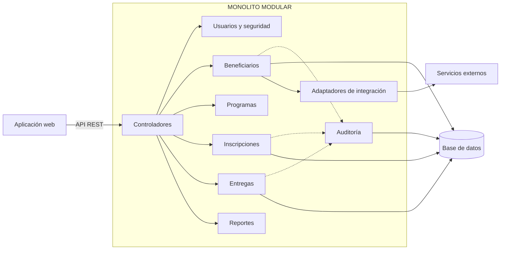

# Enfoque arquitectónico

**Proyecto:** Sistema de Gestión de Programas Sociales – Huamanga

## 1. Definición del enfoque

El **estilo** (capas) define cómo se separan las responsabilidades. El **enfoque** define cómo se aplica ese estilo al construir el sistema.

> **Enfoque adoptado: monolito modular, API-first, guiado por drivers arquitectónicos.**

| Componente del enfoque | Qué significa |
|---|---|
| Monolito modular | Una sola aplicación desplegable, organizada internamente en módulos independientes por responsabilidad del negocio. |
| API-first | La API REST se diseña primero y es el único contrato entre presentación y negocio. |
| Guiado por drivers | Cada decisión se justifica con un driver del análisis (integridad, seguridad, trazabilidad, usabilidad, mantenibilidad). |
| Integraciones aisladas | Los servicios externos se acceden mediante adaptadores, no directamente desde la lógica. |

## 2. Principios

| Principio | Aplicación en el proyecto |
|---|---|
| Separación de responsabilidades | Cada capa y módulo tiene una única razón de cambio. |
| Bajo acoplamiento entre módulos | Los módulos se comunican por interfaces del servicio, no accediendo a tablas ajenas. |
| Seguridad por diseño | Autenticación y autorización obligatorias en toda operación de la API. |
| Trazabilidad por defecto | Toda modificación del padrón y toda entrega generan un registro de auditoría. |
| Extensibilidad | Un nuevo programa social se agrega como módulo, sin modificar los existentes. |

## 3. Módulos de la capa de negocio

| Módulo | Responsabilidad |
|---|---|
| Usuarios y seguridad | Registro, autenticación, roles y permisos. |
| Beneficiarios | Registro y actualización de personas, validación de unicidad. |
| Programas | Definición de programas (Vaso de Leche, Comedores Populares) y sus reglas de elegibilidad. |
| Inscripciones | Alta y baja de beneficiarios en cada programa. |
| Entregas | Registro de raciones o productos entregados por comité o comedor. |
| Reportes | Consultas y reportes del padrón y de las entregas. |
| Auditoría | Registro de acciones sobre el padrón y las entregas. |

## 4. Tácticas por driver

| Driver | Táctica | Dónde se aplica |
|---|---|---|
| D1 Integridad del padrón | Restricción de unicidad por documento de identidad; validación previa a registrar. | Beneficiarios, base de datos. |
| D2 Protección de datos | Autenticación con token, control de acceso por roles (RBAC), cifrado de contraseñas y uso de HTTPS. | Usuarios y seguridad. |
| D3 Trazabilidad | Registro de auditoría con usuario, fecha y operación. | Auditoría. |
| D4 Usabilidad | Formularios simples, validaciones claras y mensajes de error comprensibles. | Presentación. |
| D5 Mantenibilidad | Módulos con límites claros y pruebas por módulo. | Toda la capa de negocio. |
| D6 Integración | Patrón adaptador con una interfaz por servicio externo; simulación (mock) en el prototipo académico. | Adaptadores de integración. |
| D8 Disponibilidad | Respaldos periódicos de la base de datos y manejo de fallos de servicios externos. | Datos e integraciones. |

## 5. Decisiones arquitectónicas

| ID | Decisión | Justificación |
|---|---|---|
| ADR-01 | Estilo en capas (3 capas). | Simplicidad y coherencia con los drivers (ver `estilo-arquitectonico.md`). |
| ADR-02 | Monolito modular. | Equipo de 2 personas, carga moderada, transacciones simples. |
| ADR-03 | API REST con formato JSON. | Restricción del proyecto y desacople entre presentación y negocio. |
| ADR-04 | Autenticación por token y roles. | Protección de datos personales y control de acceso por perfil. |
| ADR-05 | Base de datos relacional. | Integridad referencial y restricciones de unicidad del padrón. |
| ADR-06 | Tabla de auditoría. | Trazabilidad de cambios y entregas. |
| ADR-07 | Adaptadores para sistemas externos. | Aislar cambios en servicios de terceros. |

## 6. Estructura de código propuesta

```
programas-sociales/
├── frontend/              # Capa de presentación
└── backend/
    ├── api/               # Controladores REST
    ├── modules/
    │   ├── usuarios/
    │   ├── beneficiarios/
    │   ├── programas/
    │   ├── inscripciones/
    │   ├── entregas/
    │   ├── reportes/
    │   └── auditoria/
    ├── integraciones/     # Adaptadores a sistemas externos
    └── datos/             # Acceso a la base de datos
```

## 7. Diagrama de módulos



## 8. Riesgos y evolución

| Riesgo | Respuesta |
|---|---|
| Los módulos se acoplan con el tiempo. | Revisiones de código y límites explícitos por módulo. |
| Crecimiento de usuarios o programas. | Replicar la aplicación; si un módulo lo exige, extraerlo como servicio independiente. |
| Cambios en servicios externos. | Los adaptadores confinan el impacto a una sola pieza. |