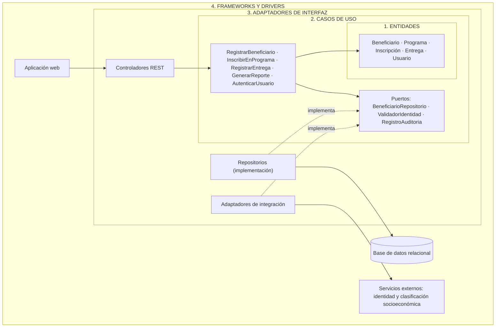
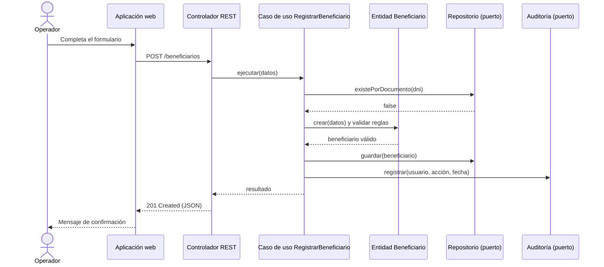

@'
# Enfoque arquitectónico: Arquitectura Limpia (Clean Architecture)

**Proyecto:** Sistema de Gestión de Programas Sociales – Huamanga
**Curso:** Arquitectura de Software (IS-488) – Semestre 2026-II
**Integrantes:** Cárdenas García, Yery May · Chipana Nuñez, Ever Neils

## 1. Definición del enfoque

El **estilo** (arquitectura en capas, monolito) define cómo se separan las responsabilidades. El **enfoque** define cómo se organiza el código dentro de esas capas.

> **Enfoque adoptado: Arquitectura Limpia (Clean Architecture), aplicada a un monolito modular con API REST.**

La Arquitectura Limpia organiza el sistema en círculos concéntricos. El centro contiene las reglas del negocio, y las tecnologías (base de datos, web, servicios externos) quedan en el borde. Su regla central es:

> **Regla de dependencia:** las dependencias del código fuente solo apuntan hacia adentro. Una capa interna nunca conoce a una capa externa.

| Componente del enfoque | Qué significa en este proyecto |
|---|---|
| Dominio en el centro | Las reglas del padrón (unicidad del beneficiario, elegibilidad) no dependen de ninguna tecnología. |
| Casos de uso | Cada acción del sistema (registrar beneficiario, inscribir, registrar entrega) es una clase independiente y probable. |
| Puertos y adaptadores | Los casos de uso definen interfaces (puertos); la base de datos y los servicios externos las implementan (adaptadores). |
| Independencia tecnológica | Se puede cambiar el framework, la base de datos o la interfaz sin tocar las reglas del negocio. |
| Testabilidad | Los casos de uso se prueban sin base de datos ni servidor web. |

## 2. Las cuatro capas

| Capa (de adentro hacia afuera) | Responsabilidad | Contenido en el proyecto |
|---|---|---|
| 1. Entidades (dominio) | Reglas del negocio puras y de mayor estabilidad. | Beneficiario, Programa, Inscripción, Entrega, Usuario, DocumentoIdentidad. |
| 2. Casos de uso (aplicación) | Reglas propias de la aplicación; orquestan las entidades. Definen los puertos. | RegistrarBeneficiario, InscribirEnPrograma, RegistrarEntrega, GenerarReporte, AutenticarUsuario. |
| 3. Adaptadores de interfaz | Convierten datos entre el formato de los casos de uso y el de las tecnologías. | Controladores REST, presentadores (DTO/JSON), implementación de repositorios, adaptadores de servicios externos. |
| 4. Frameworks y drivers | Detalles tecnológicos intercambiables. | Framework web, base de datos relacional, aplicación web (UI), servicios externos de identidad. |

## 3. Diagrama de capas y regla de dependencia



Las flechas continuas son dependencias de uso y apuntan hacia adentro. Las líneas punteadas muestran la **inversión de dependencias**: el caso de uso define la interfaz y la infraestructura la implementa.

## 4. Flujo de ejemplo: registrar un beneficiario



## 5. Principios aplicados

| Principio | Aplicación en el proyecto |
|---|---|
| Regla de dependencia | Dominio y casos de uso no importan nada de web, base de datos ni servicios externos. |
| Inversión de dependencias | Los casos de uso definen puertos; la infraestructura los implementa. |
| Responsabilidad única | Cada caso de uso resuelve una sola acción del negocio. |
| Independencia de frameworks | El framework web es un detalle de la capa externa. |
| Independencia de la base de datos | El dominio no conoce el motor; el acceso se hace mediante repositorios. |
| Testabilidad | Los casos de uso se prueban con repositorios simulados (mock). |
| Seguridad y trazabilidad por diseño | La autorización y la auditoría se invocan desde los casos de uso, no desde la interfaz. |

## 6. Tácticas por driver

> Los IDs D1 a D8 corresponden a los drivers de `estilo-arquitectonico.md`.

| Driver | Táctica | Dónde se aplica |
|---|---|---|
| D1 Integridad del padrón | Regla de unicidad de documento de identidad en el dominio, reforzada con restricción única en la base de datos. | Entidades, caso de uso RegistrarBeneficiario, repositorio. |
| D2 Protección de datos | Autenticación con token, control de acceso por roles (RBAC) verificado en cada caso de uso, cifrado de contraseñas y HTTPS. | Casos de uso, controladores. |
| D3 Trazabilidad | Puerto RegistroAuditoria invocado por todo caso de uso que modifique el padrón o registre una entrega. | Casos de uso, adaptador de auditoría. |
| D4 Usabilidad | Presentadores que traducen errores del dominio a mensajes claros; formularios simples. | Adaptadores de interfaz, UI. |
| D5 Mantenibilidad | Un programa social nuevo agrega entidades y casos de uso sin modificar los existentes. | Dominio y casos de uso. |
| D6 Integración | Puerto ValidadorIdentidad con un adaptador por servicio; versión simulada (mock) en el prototipo. | Casos de uso, adaptadores de integración. |
| D7 Equipo pequeño y restricciones | Un único despliegue (monolito modular) con una API REST como contrato con la UI. | Todo el sistema. |
| D8 Disponibilidad | Respaldos de la base de datos y manejo de fallos de los servicios externos dentro de los adaptadores. | Frameworks y drivers, adaptadores. |

## 7. Decisiones arquitectónicas

| ID | Decisión | Justificación |
|---|---|---|
| ADR-01 | Estilo en capas como monolito. | Simplicidad y coherencia con los drivers (ver `estilo-arquitectonico.md`). |
| ADR-02 | Arquitectura Limpia como enfoque de organización interna. | Protege las reglas del padrón de cambios tecnológicos y facilita las pruebas. |
| ADR-03 | Casos de uso como unidad de la capa de aplicación. | Cada funcionalidad queda aislada, trazable a una historia de usuario y probable. |
| ADR-04 | Repositorios y servicios externos detrás de puertos. | Permite cambiar la base de datos o el proveedor sin tocar el negocio. |
| ADR-05 | API REST con formato JSON. | Restricción del proyecto y desacople entre UI y aplicación. |
| ADR-06 | Autenticación por token y roles. | Protección de datos personales y control de acceso por perfil. |
| ADR-07 | Base de datos relacional. | Integridad referencial y restricciones de unicidad del padrón. |
| ADR-08 | Auditoría como puerto del caso de uso. | Trazabilidad garantizada en todas las operaciones sensibles. |

## 8. Estructura de código propuesta

```
programas-sociales/
├── frontend/                          # 4. Frameworks y drivers (UI)
└── backend/
    ├── dominio/                       # 1. Entidades
    │   ├── beneficiario/
    │   ├── programa/
    │   ├── inscripcion/
    │   ├── entrega/
    │   └── usuario/
    ├── aplicacion/                    # 2. Casos de uso
    │   ├── casos-de-uso/
    │   │   ├── registrar-beneficiario
    │   │   ├── inscribir-en-programa
    │   │   ├── registrar-entrega
    │   │   ├── generar-reporte
    │   │   └── autenticar-usuario
    │   └── puertos/                   # Interfaces (repositorios, validador, auditoría)
    ├── adaptadores/                   # 3. Adaptadores de interfaz
    │   ├── entrada/                   # Controladores REST y presentadores
    │   └── salida/                    # Repositorios, integraciones, auditoría
    └── infraestructura/               # 4. Frameworks y drivers
        ├── web/                       # Configuración del servidor
        └── base-de-datos/             # Conexión y migraciones
```

## 9. Consecuencias

**Ventajas**
- Las reglas del padrón no dependen de ninguna tecnología.
- Fácil de probar: los casos de uso se ejecutan sin base de datos ni servidor.
- Se puede cambiar de base de datos, de framework o de proveedor externo con impacto acotado.
- Cada caso de uso se vincula con una historia de usuario.

**Desventajas y mitigación**

| Desventaja | Mitigación |
|---|---|
| Más archivos e interfaces que una arquitectura en capas simple. | Crear puertos solo para dependencias reales (base de datos, identidad, auditoría). |
| Curva de aprendizaje para el equipo. | Empezar con un caso de uso completo (RegistrarBeneficiario) y usarlo como plantilla. |
| Riesgo de transformar datos en exceso entre capas. | Usar DTO únicamente en los límites (controladores y repositorios). |
| Los módulos pueden acoplarse con el tiempo. | Revisar que las importaciones respeten la regla de dependencia. |
'@ | Set-Content -Path arquitectura/enfoque-arquitectonico.md -Encoding utf8