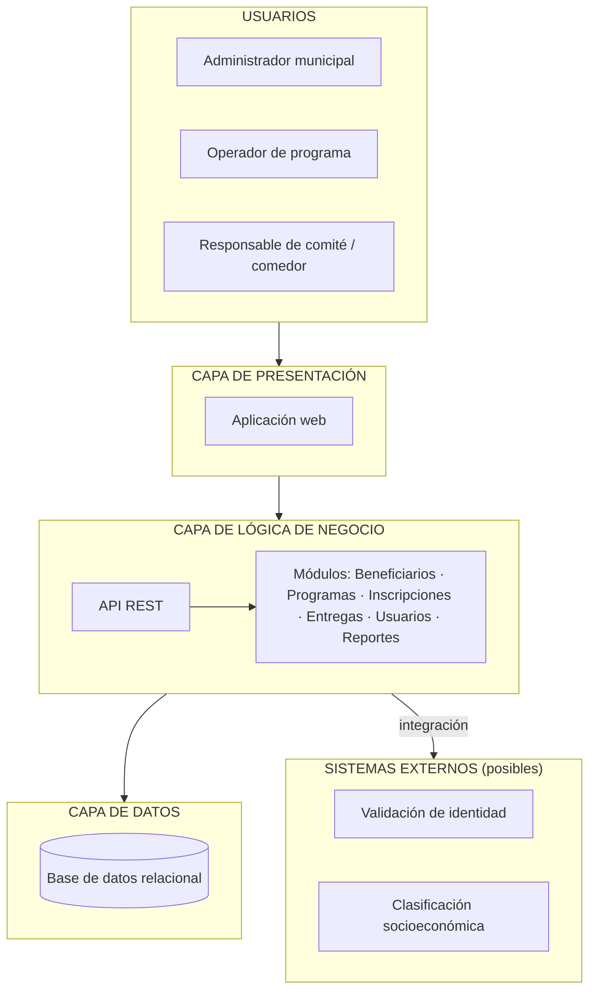

# Estilo arquitectónico

**Proyecto:** Sistema de Gestión de Programas Sociales – Huamanga
**Curso:** Arquitectura de Software (IS-488) – Semestre 2026-II
**Integrantes:** Cárdenas García, Yery May · Chipana Nuñez, Ever Neils

## 1. Contexto

El sistema centraliza el padrón de beneficiarios del **Vaso de Leche** y de los **Comedores Populares** de la Municipalidad de Huamanga. Hoy esa información suele estar dispersa en listas y hojas de cálculo por comité o comedor, lo que genera duplicados, errores y poca trazabilidad.

## 2. Drivers que condicionan la elección

| ID | Driver | Tipo |
|---|---|---|
| D1 | El padrón debe ser íntegro: sin beneficiarios duplicados dentro de un programa ni entre programas. | Requisito / calidad |
| D2 | Los datos personales deben protegerse (Ley N.° 29733, Protección de Datos Personales). | Calidad / restricción legal |
| D3 | Cada cambio del padrón y cada entrega deben ser trazables (quién, cuándo, qué). | Calidad |
| D4 | El personal municipal y los responsables de comités tienen poca experiencia técnica. | Calidad (usabilidad) |
| D5 | Deben poder añadirse nuevos programas sociales sin rehacer el sistema. | Calidad (mantenibilidad) |
| D6 | Debe poder integrarse con servicios externos de validación (identidad, clasificación socioeconómica). | Restricción |
| D7 | Aplicación web con API REST, Git/GitHub y un equipo de 2 personas. | Restricción de proyecto |
| D8 | Disponibilidad en horario laboral y carga moderada y predecible (una municipalidad provincial). | Calidad |

## 3. Estilos candidatos

| Criterio | Capas (monolito) | Microservicios | Hexagonal | Orientada a eventos |
|---|:-:|:-:|:-:|:-:|
| Simplicidad y costo (D7, D8) | 5 | 1 | 3 | 2 |
| Integridad de datos con transacciones (D1) | 5 | 2 | 5 | 3 |
| Seguridad y auditoría centralizadas (D2, D3) | 4 | 3 | 4 | 3 |
| Mantenibilidad y evolución (D5) | 4 | 4 | 5 | 3 |
| Capacidad del equipo (D7) | 5 | 1 | 3 | 2 |
| Escalabilidad | 3 | 5 | 3 | 5 |
| **Total (máx. 30)** | **26** | **16** | **23** | **18** |

*Puntuación cualitativa de 1 (desfavorable) a 5 (favorable), según los drivers.*

## 4. Decisión

**Se adopta una arquitectura en capas (3 capas) desplegada como monolito.**

Es la continuación de la arquitectura inicial del Entregable 02.

| Driver | Por qué las capas lo favorecen |
|---|---|
| D1 | Un solo almacén de datos permite transacciones y restricciones de unicidad (por ejemplo, DNI único por programa). |
| D2, D3 | La seguridad y la auditoría se aplican en un único punto, la capa de lógica de negocio. |
| D4 | La capa de presentación se diseña solo para el usuario, sin mezclar reglas. |
| D5 | Cada programa social es un módulo nuevo en la capa de negocio. |
| D6 | Las integraciones externas se encapsulan en la capa de negocio. |
| D7, D8 | Es simple de construir, probar y desplegar con un equipo de dos personas. |

## 5. Capas y responsabilidades

| Capa | Responsabilidad | Contiene |
|---|---|---|
| Presentación | Interacción con el usuario. | Aplicación web, consumo de la API REST. |
| Lógica de negocio | Reglas del dominio, validaciones, seguridad y auditoría. | Módulos de beneficiarios, programas, inscripciones, entregas, usuarios y reportes. |
| Datos | Persistencia de la información. | Base de datos relacional. |

**Regla de dependencia:** cada capa solo se comunica con la inmediata inferior. La presentación nunca accede directamente a la base de datos.

## 6. Diagrama

## 7. Consecuencias

**Ventajas**
- Menor complejidad y costo de desarrollo y despliegue.
- Consistencia fuerte del padrón gracias a transacciones.
- Seguridad y auditoría en un solo lugar.

**Desventajas y mitigación**

| Desventaja | Mitigación |
|---|---|
| Escalar implica escalar todo el sistema. | La carga es moderada; se puede replicar la aplicación si crece. |
| Riesgo de acoplamiento entre módulos. | Organizar el código por módulos con límites claros (ver enfoque arquitectónico). |
| Un fallo puede afectar a todo el sistema. | Respaldos periódicos y manejo de errores en las integraciones. |
