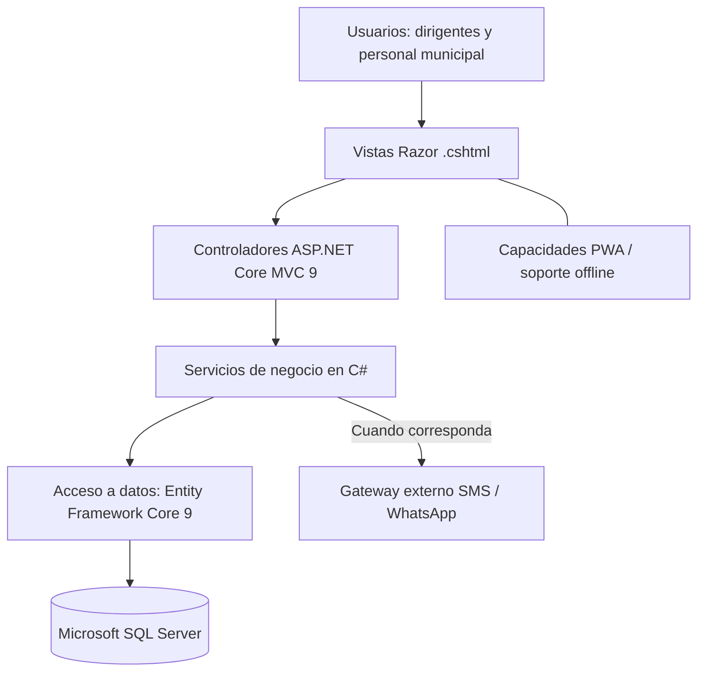

# Estilo arquitectónico

**Proyecto:** Sistema de Gestión de Programas Sociales – Huamanga  
**Curso:** Arquitectura de Software (IS-488) – Semestre 2026-II  
**Integrantes:** Cárdenas García, Yery May · Chipana Nuñez, Ever Neils

## 1. Contexto

El sistema centraliza el padrón de beneficiarios del Programa del Vaso de Leche y de los Comedores Populares de la Municipalidad Provincial de Huamanga. Busca reducir duplicados, mejorar la trazabilidad y facilitar la consulta de cobertura y reportes.

## 2. Drivers que condicionan la elección

| ID | Driver | Tipo |
|---|---|---|
| D1 | El padrón debe mantener la integridad y evitar registros duplicados. | Requisito / calidad |
| D2 | Los datos personales deben protegerse de acuerdo con la Ley N.° 29733. | Calidad / restricción legal |
| D3 | Los cambios del padrón deben ser trazables: quién realizó el cambio y cuándo. | Calidad |
| D4 | El personal municipal y los responsables de comités necesitan una interfaz sencilla. | Calidad (usabilidad) |
| D5 | Deben poder incorporarse nuevos programas sociales sin rehacer todo el sistema. | Calidad (mantenibilidad) |
| D6 | Las integraciones externas deben poder incorporarse sin acoplarlas a las vistas. | Restricción de diseño |
| D7 | El proyecto debe ser viable para un equipo de dos personas y gestionarse con Git/GitHub. | Restricción de proyecto |
| D8 | La carga prevista corresponde a una municipalidad provincial y es moderada. | Calidad |

## 3. Estilos candidatos

| Criterio | Capas (monolito modular) | Microservicios | Hexagonal | Orientada a eventos |
|---|:-:|:-:|:-:|:-:|
| Simplicidad y costo (D7, D8) | 5 | 1 | 3 | 2 |
| Integridad de datos y transacciones (D1) | 5 | 2 | 5 | 3 |
| Seguridad y auditoría centralizadas (D2, D3) | 4 | 3 | 4 | 3 |
| Mantenibilidad y evolución (D5) | 4 | 4 | 5 | 3 |
| Adecuación al tamaño del equipo (D7) | 5 | 1 | 3 | 2 |
| Escalabilidad | 3 | 5 | 3 | 5 |
| **Total (máx. 30)** | **26** | **16** | **23** | **18** |

*Puntuación cualitativa de 1 (desfavorable) a 5 (favorable), según los drivers del proyecto.*

## 4. Decisión arquitectónica

Se adopta una **arquitectura en capas implementada como monolito modular**, utilizando el patrón **MVC (Modelo-Vista-Controlador) de ASP.NET Core 9**.

La elección reduce la complejidad de desarrollo y despliegue, facilita las transacciones sobre el padrón y permite mantener los módulos organizados con responsabilidades claras. Esta decisión sigue el stack definido en el `README.md`: C#, ASP.NET Core 9 MVC, vistas Razor, Entity Framework Core 9 y Microsoft SQL Server.

| Driver | Justificación |
|---|---|
| D1 | La persistencia centralizada permite aplicar validaciones y restricciones de integridad en SQL Server. |
| D2, D3 | Las reglas de seguridad y auditoría se gestionan en la aplicación y se aplican de forma consistente. |
| D4 | Las vistas Razor permiten construir formularios y pantallas integradas con ASP.NET Core MVC. |
| D5 | Los módulos del dominio se organizan de forma cohesionada dentro de una única aplicación desplegable. |
| D6 | Las integraciones externas se encapsulan en servicios, sin incorporarlas directamente a las vistas. |
| D7, D8 | La solución evita la complejidad operativa de una arquitectura distribuida. |

## 5. Capas y responsabilidades

| Capa | Responsabilidad | Tecnologías y componentes |
|---|---|---|
| Presentación | Mostrar formularios, vistas y resultados; recibir las interacciones del usuario. | ASP.NET Core MVC, vistas Razor (`.cshtml`), HTML5, CSS3 y Bootstrap; capacidades PWA según el alcance definido. |
| Lógica de negocio | Aplicar reglas, validar beneficiarios, controlar duplicados, gestionar staging, reportes y notificaciones. | C# y servicios de aplicación en ASP.NET Core 9; inyección de dependencias. |
| Acceso a datos | Consultar y persistir la información, manteniendo integridad transaccional. | Entity Framework Core 9, patrones Repository y Unit of Work cuando correspondan, Microsoft SQL Server. |

**Regla de dependencia:** las vistas no acceden directamente a la base de datos. Los controladores coordinan las peticiones y delegan las reglas a los servicios; el acceso a datos se realiza mediante la capa correspondiente.

## 6. Diagrama

Las integraciones con servicios externos se realizarán desde servicios de la aplicación. La validación directa con RENIEC y SISFOH no forma parte de la primera versión; se considera una posible ampliación futura, de acuerdo con las restricciones del proyecto.

## 7. Consecuencias

**Ventajas**
- Menor complejidad y costo de desarrollo y despliegue.
- Integridad de datos mediante transacciones y restricciones de SQL Server.
- Separación de responsabilidades y facilidad de mantenimiento.
- Integración de vistas, controladores y lógica en el stack ASP.NET Core MVC.

**Desventajas y mitigaciones**

| Desventaja | Mitigación |
|---|---|
| Para escalar se replica la aplicación completa. | La carga prevista es moderada; se evaluará el crecimiento antes de cambiar la arquitectura. |
| Los módulos pueden acoplarse con el tiempo. | Mantener límites claros, interfaces y pruebas entre módulos. |
| Un fallo de la aplicación puede afectar varias funciones. | Incorporar manejo de errores, registros de auditoría y copias de seguridad periódicas. |

## 8. Stack tecnológico de referencia

- **Backend y framework web:** C# con ASP.NET Core 9 MVC.
- **Presentación:** vistas Razor (`.cshtml`), HTML5, CSS3 y Bootstrap.
- **Persistencia / ORM:** Entity Framework Core 9, con enfoque Code-First según el diseño.
- **Base de datos:** Microsoft SQL Server.
- **Arquitectura:** monolito modular organizado en capas, con patrón MVC.
- **PWA:** capacidades web progresivas y soporte offline dentro de los límites definidos para la aplicación.

No se asumen React, Node.js, Express, Prisma ni PostgreSQL como parte del stack aprobado, ya que no corresponden a las tecnologías indicadas en el `README.md`.
